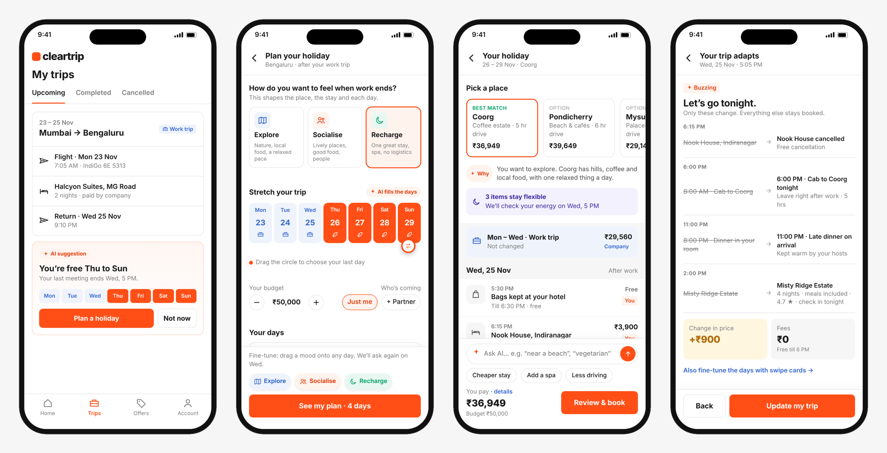
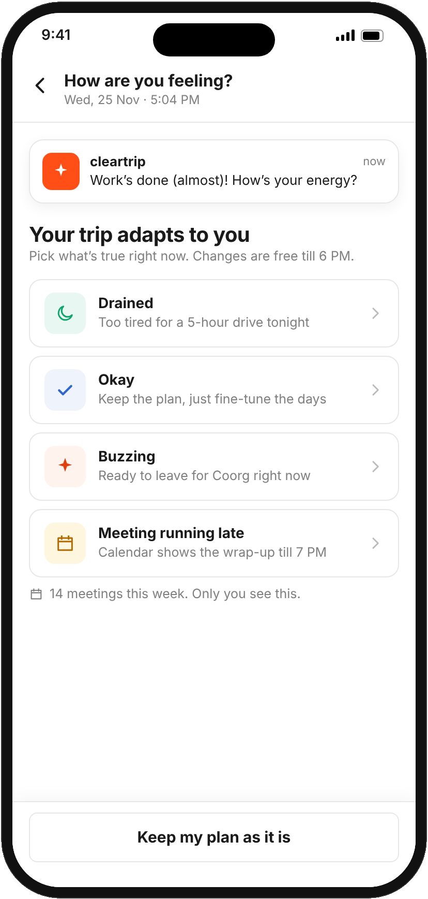
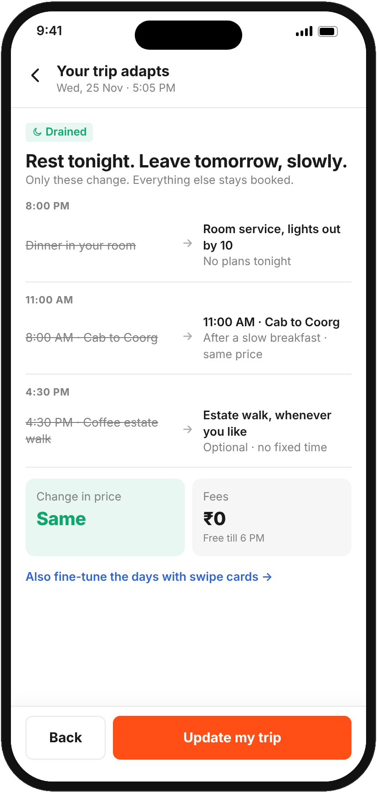
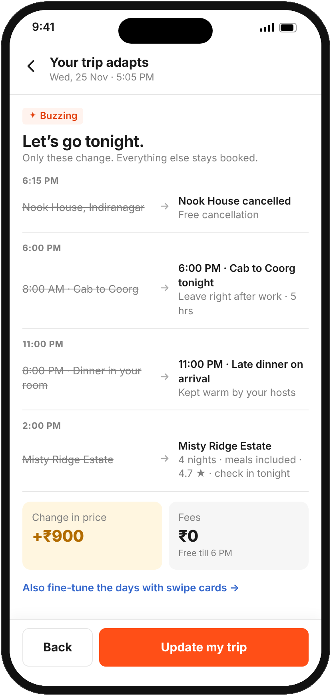
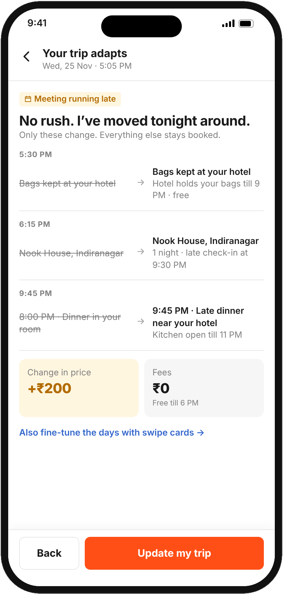
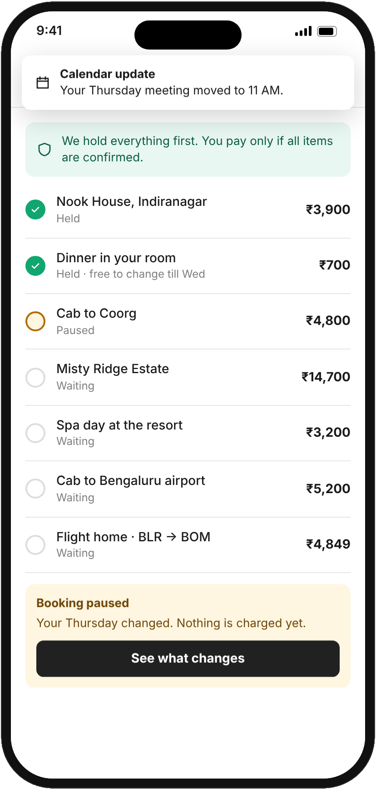
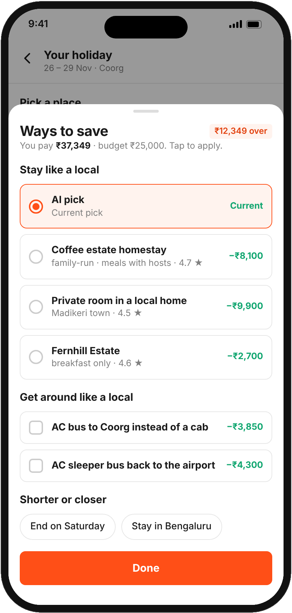
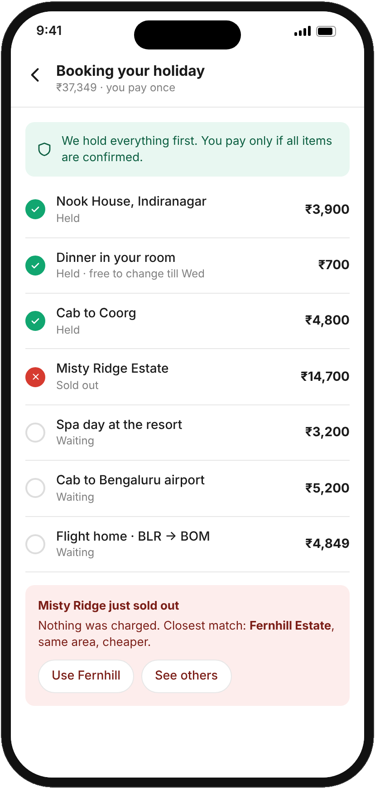
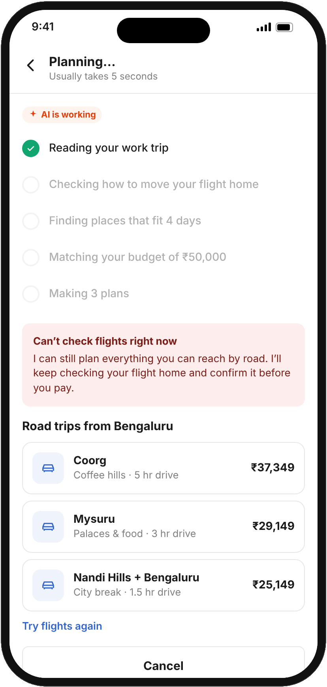
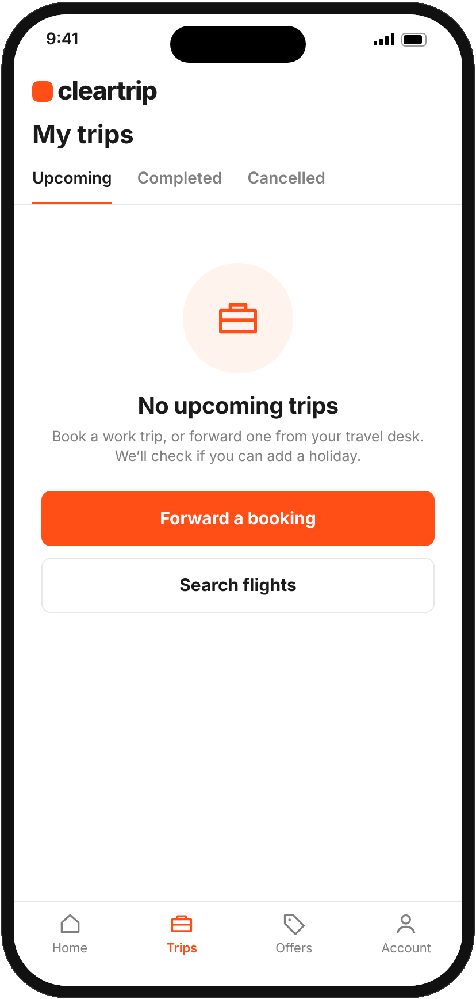

# An AI that plans around the traveller

**A Cleartrip concept for business + leisure travellers · Razorpay Design × NID assignment.**
It turns the work trip you already booked into the holiday you actually need. It doesn’t ask *“Where do you want to go?”* It asks *“How do you want to feel when work ends?”*, and on Wednesday evening it adapts the trip to your energy.

| | |
|---|---|
| ▶️ **Live prototype** | [https://YOUR-USERNAME.github.io/cleartrip-ai-holiday-planner/](https://preksha-05.github.io/RazorPay-Design-Task-/) *(best on a laptop; it also works on a phone)* |
| 📊 **Presentation** | [PDF](Docs/presentation.pdf) |
| 🗣️ **User research summary** | [User-Research-Summary.pdf](Docs/User-Research-Summary.pdf) |
| 🤖 **How I worked with AI** | [How-I-worked-with-ai](Docs/How-I-Worked-With-AI.pdf) |

---

## The problem nobody has named

**You plan the holiday on Monday, as work-you. You live it on Wednesday night, as tired-you.**

79% of Indian business travellers extend work trips for leisure, and 88% add the days at the end ([GBTA](https://travtalkindia.com/with-79-indian-business-travellers-extending-their-work-trips-for-leisure-gbta-sees-rise-in-bleisure-travel/), [Expedia Group](https://eturbonews.com/?p=231659)). Yet the travel AIs I reviewed (MakeMyTrip’s Myra, Cleartrip’s Trippy, ixigo’s TARA) are all built around a *new* request, not the trip you already have. And people are poor at predicting how they will feel later ([projection bias](https://econpapers.repec.org/RePEc:wpa:wuwpgt:0012003)).

## What three travellers told me

| Ananya, 32 · *Explorer* | Rohan, 35 · *Socialiser* | Karan, 41 · *Recharger* |
|---|---|---|
| “If I’m already away from home, I might as well see somewhere new.” | “I don’t want to waste a weekend sitting in my hotel room.” | “If I’m extending one, I want to slow down.” |

All three want the AI to take the work off their hands. **None want the same holiday.** So the first question became *how do you want to feel?* → [full research summary](User-Research-Summary.pdf)

---

## The journey

| Step | What happens |
|---|---|
| **1. AI finds free days** | Reads your work trip and calendar: *“You’re free Thu to Sun.”* |
| **2. Stretch your trip** | Pick a feeling (**Explore · Socialise · Recharge**), drag your last day, drop moods onto days. No form, no chatbot. |
| **3. Review your plan** | Best-match place with one line on *why*. Every item shows who pays, plus *Why · Change · Lock*. “Ask AI” for anything else. |
| **4. Confirm & book** | Company cost unchanged and policy-checked, holiday kept private, then *hold everything, pay once*. |
| **5. Booked** | Two separate invoices: company and personal. |
| **6. Wednesday check-in** | At 5 PM the app asks *“How’s your energy?”* **Drained** → rest tonight, leave late morning. **Buzzing** → leave tonight. **Meeting running late** → the evening is rearranged. Only affected items change, with no fees. |

   

**Edge, empty, loading and error states**, each one click in the prototype. Every problem comes with a way forward: *meeting moved mid-booking* (booking pauses) · *over budget* (homestays, a room in a local home, buses) · *flights down* (road trips to Coorg, Mysuru or a city break) · *sold out while holding* (closest match) · *no trips yet*.

---

## Run it

There’s no build step and no dependencies: open `index.html` in a browser. On a laptop, the top bar lets you jump to any screen or trigger an edge case, and dotted notes explain each feature.

---

Student concept by Preksha (National Institute of Design). Not affiliated with or endorsed by Cleartrip. All prices, places, people and availability in the prototype are simulated.
